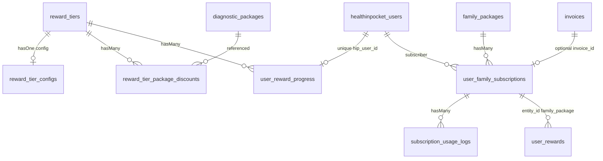

# Reward Tiers & Membership Packages

Documentation of two admin-configured patient benefit systems in the HealthInPocket (HIP) Laravel backend. Based on codebase inspection of routes, Livewire components, models, migrations, services, and API controllers.

> **Naming note:** Admin UI routes and labels use **“Membership Packages”**, but the domain models and APIs use **Family Packages** (`FamilyPackage`, `UserFamilySubscription`, `/api/family-packages`). There is no `MembershipPackage` model.

---

## Table of contents

1. [Overview](#1-overview)
2. [Reward Tiers Module](#2-reward-tiers-module)
   - [2.1 Page details](#21-page-details)
   - [2.2 Fields and properties](#22-fields-and-properties)
   - [2.3 Admin operations](#23-admin-operations)
   - [2.4 Reward tier business logic](#24-reward-tier-business-logic)
   - [2.5 Patient/user-side workflow](#25-patientuser-side-workflow)
3. [Membership Packages Module](#3-membership-packages-module)
   - [3.1 Page details](#31-page-details)
   - [3.2 Package fields](#32-package-fields)
   - [3.3 Admin operations](#33-admin-operations)
   - [3.4 Membership purchase and subscription lifecycle](#34-membership-purchase-and-subscription-lifecycle)
   - [3.5 Patient and family user-side workflow](#35-patient-and-family-user-side-workflow)
4. [Reward Tiers vs Membership Packages](#4-reward-tiers-vs-membership-packages)
5. [Database schema and relationships](#5-database-schema-and-relationships)
6. [API and application integration](#6-api-and-application-integration)
7. [Business rules and calculations](#7-business-rules-and-calculations)
8. [Edge cases and failure scenarios](#8-edge-cases-and-failure-scenarios)
9. [Permissions and security](#9-permissions-and-security)
10. [File reference index](#10-file-reference-index)
11. [Implementation status and verification checklist](#11-implementation-status-and-verification-checklist)

---

## 1. Overview

### Purpose of Reward Tiers

Reward Tiers are a **loyalty progression system**. Admins define ordered tiers (for example Bronze → Silver → Gold) with:

- A minimum coin threshold (`min_coins`) used to unlock the next tier
- Configured benefits stored per tier (`total_discount_percentage`, `free_checkup_count`, `earned_coins_per_booking`)
- Optional diagnostic-package promotions (`reward_tier_package_discounts`)

Patients accumulate **tier progress coins** in `user_reward_progress` (separate from the spendable HIP Coins wallet). When in-tier earnings reach the next tier’s `min_coins`, the patient is upgraded and `earned_coins_in_tier` resets to `0`.

### Purpose of Membership Packages

Membership Packages (Family Packages) are **paid subscriptions** with time-bounded entitlements:

- Price and validity in days
- Limits for family members, consultations, lab tests, and a configured `max_hip_coins` value
- Branch scope, marketing benefits text, and terms/conditions
- Usage tracked in `subscription_usage_logs`

### Difference between the two modules

| | Reward Tiers | Membership Packages |
|---|---|---|
| Nature | Loyalty ladder based on earned progress | Purchasable subscription product |
| Qualification | Automatic via earning progress coins | Payment / staff activation |
| Primary tables | `reward_tiers`, `user_reward_progress` | `family_packages`, `user_family_subscriptions` |
| Admin URL | `/admin/settings/reward-tiers` | `/admin/membership-packages` |

### Relation to patient experience

- **Reward Tiers:** Patients can read progress via `GET /api/user/reward-progress`. Progress is updated when bookings/payments award coins through `RewardTierService::addEarnedCoins`.
- **Membership Packages:** Patients can list packages, subscribe, view active subscription/history, and cancel via Family Package APIs. Profile “Membership & Plans” data is built in `HomePageController::buildProfileMembershipPlan`. Staff (cashier/pharmacist/technician/receptionist) can create/renew subscriptions.

### Interactions with HIP Coins, consultations, lab tests, discounts, and package benefits

**Verified interactions:**

- **HIP Coins wallet vs tier progress:** Separate systems. Wallet coins live in the `coins` table (via payment/booking flows). Tier progress lives in `user_reward_progress`. Payment flow credits ~1% of payable amount to the wallet and also calls `syncRewardTierProgress`. Booking flow adds progress coins (`1% of paid amount` + tier `earned_coins_per_booking`) without necessarily being the same path as wallet credit.
- **Membership consultations / lab tests:** Doctor bookings call `FamilyPackageService::tryLogBookingUsage(..., 'consultation', ...)`. Diagnostic bookings call `tryLogBookingUsage(..., 'lab_test', ...)`.
- **Membership invoice coins:** Cashier family-package invoices set `coins_earned = round(amount * 0.01)` when status is `completed` (`FamilyPackageService::createFamilyPackageInvoice`).
- **Tier discount / free checkup / package discounts:** Stored and editable in admin UI; `total_discount_percentage` is exposed in the reward-progress API. **Runtime application of these benefits during booking/pricing was not found** (see §2.4).
- **Membership `max_hip_coins`:** Stored and returned as `usage_summary.hip_coins_balance` (equals package max). **No verified code logs `usage_type = hip_coins` or credits package HIP coins into the patient wallet on activation.**
- **Cross-module coupling:** No verified code path where a reward tier changes membership entitlements, or a membership package changes reward tier assignment. They operate independently except that both can be triggered around bookings/payments.

---

## 2. Reward Tiers Module

### 2.1 Page details

| Item | Value |
|---|---|
| Admin URL | `/admin/settings/reward-tiers` |
| Route name | `admin.settings.reward-tiers` |
| Middleware | `auth:filament`, `account.active`, `role:super-admin-hip` |
| Livewire component | `App\Livewire\Admin\Settings\RewardTiers` |
| Blade view | `resources/views/livewire/admin/settings/reward-tiers.blade.php` |
| Layout | `layouts.admin` |
| Service | `App\Services\RewardTierService` |
| Models | `RewardTier`, `RewardTierConfig`, `RewardTierPackageDiscount`, `UserRewardProgress` |
| Tables | `reward_tiers`, `reward_tier_configs`, `reward_tier_package_discounts`, `user_reward_progress` |
| Patient API | `GET /api/user/reward-progress` → `HomePageController::rewardProgress` |
| Event (registered, not dispatched in production) | `App\Modules\Automation\Events\RewardTierUpgraded` |
| Jobs | **Not verified in codebase** (no dedicated Reward Tier job) |

**Hospital-admin counterpart**

| Item | Value |
|---|---|
| URL | `/healthcare/settings/reward-tiers` |
| Route name | `healthcare.settings.reward-tiers` |
| Middleware | `role:healthcare_admin` (with filament auth) |
| Livewire | `App\Livewire\HospitalAdmin\Settings\RewardTiers` |
| View | `resources/views/livewire/hospital-admin/settings/reward-tiers.blade.php` |
| Difference | Diagnostic packages for package-discount rows are scoped to the admin’s `organization_id` |

### 2.2 Fields and properties

Fields from Add/Edit modal (`RewardTiers` Livewire + migrations).

| Field | Database Column | Data Type | Required? | Validation | Purpose | Example |
|---|---|---|---|---|---|---|
| Tier name | `reward_tiers.name` | `string` | Yes | `required\|string\|max:100` | Display name of the tier | `Bronze` |
| Description | `reward_tiers.description` | `text`, nullable | No | Not in `$this->validate()` rules; saved from `$this->description` | Optional admin description | `Entry loyalty tier` |
| Minimum HIP Coins (threshold) | `reward_tiers.min_coins` | `unsignedInteger`, default `0` | Yes | `required\|integer\|min:0` | Threshold used when deciding upgrade to this tier from a lower tier (`nextTier.min_coins`) | `500` |
| Sort order | `reward_tiers.sort_order` | `unsignedInteger`, default `1` | Yes | `required\|integer\|min:1` | Display/order; “Bronze” default is active tier with `sort_order === 1` | `1` |
| Active | `reward_tiers.is_active` | `boolean`, default `true` | No (boolean toggle) | Bound as boolean; not separately validated | Inactive tiers are excluded from `RewardTier::active()` used in upgrades | `true` |
| Total discount % | `reward_tier_configs.total_discount_percentage` | `decimal(5,2)`, nullable | No | `nullable\|numeric\|min:0\|max:100` | Configured discount percentage for the tier; returned in API payload | `10.00` |
| Free checkup count | `reward_tier_configs.free_checkup_count` | `unsignedInteger`, default `0` | No | `nullable\|integer\|min:0` | Configured free checkup allowance | `1` |
| Coins earned per booking | `reward_tier_configs.earned_coins_per_booking` | `unsignedInteger`, default `0` | Yes | `required\|integer\|min:0` | Bonus progress coins added on booking award | `5` |
| Package (diagnostic) | `reward_tier_package_discounts.diagnostic_package_id` | FK → `diagnostic_packages.id` | Yes (per row) | `required\|exists:diagnostic_packages,id` | Which diagnostic package the promotion applies to | `12` |
| Promotion type | `reward_tier_package_discounts.promotion_type` | enum `discount`,`free` | Yes (per row) | `required\|in:discount,free` | Discount vs free package promotion | `discount` |
| Discount type | `reward_tier_package_discounts.discount_type` | enum `percentage`,`flat`, nullable | Required if promotion is `discount` | `required_if:...\|nullable\|in:percentage,flat` | How discount value is interpreted | `percentage` |
| Discount value | `reward_tier_package_discounts.discount_value` | `decimal(8,2)`, nullable | Required if promotion is `discount` | `required_if:...\|nullable\|numeric\|min:0` | Discount amount or percent | `15` |

Soft delete: `reward_tiers.deleted_at` (SoftDeletes). Config and package-discount rows cascade on hard FK delete of tier; soft-delete of tier does not automatically remove them via SoftDeletes alone.

### 2.3 Admin operations

| Operation | How it works | Implementing code |
|---|---|---|
| View tiers | `mount` / `loadTiers` loads all tiers with config and package discounts, ordered by `sort_order` | `RewardTiers::loadTiers`, `RewardTierService::getAllTiers` |
| Add tier | `openCreate` → modal → `save` → `createTier` in a DB transaction (tier + config + package rows) | `RewardTiers::save`, `RewardTierService::createTier` |
| Edit tier | `openEdit` hydrates form; `save` → `updateTier` (update tier, `updateOrCreate` config, delete+recreate package discounts) | `RewardTiers::openEdit` / `save`, `RewardTierService::updateTier` |
| Activate / deactivate | Toggle `is_active` on the form and save; **no dedicated activate endpoint** | Form field `is_active` |
| Delete tier | Confirm modal → `deleteTier` soft-deletes the `RewardTier` row | `RewardTiers::deleteTier`, `RewardTierService::deleteTier` |
| Configure benefits | Config fields + dynamic package discount rows (`addPackageRow` / `removePackageRow`) | Same Livewire component |
| Configure ordering | Admin sets `sort_order` integer | Field `sort_order` |
| Validation / errors | Livewire validation rules; Flux toast on success (admin). Hospital admin uses `$this->dispatch('toast', ...)` | `save()` validation array |

**Delete restrictions / cascading:** Soft delete only. No code check preventing delete when users still reference the tier in `user_reward_progress`. FK on `user_reward_progress.reward_tier_id` is `constrained` without `nullOnDelete`/`cascadeOnDelete` in the progress migration (restrict-style default). **Behavior when deleting a tier that still has progress rows: Not fully verified beyond SoftDeletes (soft-deleted rows remain in DB).**

### 2.4 Reward tier business logic

#### How patient coin balance is calculated

Two distinct concepts:

1. **Spendable wallet balance** — `coins` table / `HomePageController` coin endpoints (`/api/home/user-coins`, etc.). Not the reward-tier progress counter.
2. **Tier progress** — `user_reward_progress.earned_coins_in_tier` and `total_lifetime_coins`, updated by `RewardTierService::addEarnedCoins`.

There is **no** column named `coin_balance` in the reward-tier schema.

#### How the patient's tier is determined

- Stored as `user_reward_progress.reward_tier_id`.
- `getTierForUser` returns that tier, else Bronze (`sort_order = 1` active), else first by `sort_order`.
- On register, `AuthService` calls `enrollUserOnRegister` to create progress at Bronze if missing.

#### Threshold basis

Upgrade compares **`earned_coins_in_tier`** (current in-tier progress) against the **next** active tier’s **`min_coins`**, not current wallet balance and not exclusively lifetime coins (though lifetime is incremented in parallel).

Verified in `RewardTierService::addEarnedCoins` (lines 80–109).

#### Automatic vs manual assignment

**Automatic.** No admin UI to manually assign a patient’s tier was found. Enrollment on register + upgrade loop on coin earn.

#### When eligibility is recalculated

On each successful `addEarnedCoins` call (booking award and payment sync). Not on a schedule.

#### Discounts during bookings

`total_discount_percentage` is returned by `getRewardProgressPayload`. **No verified booking/pricing code applies this percentage to consultation or lab prices.**

#### Free checkups

`free_checkup_count` is stored in config and shown in admin UI. It is **commented out** in the API payload. **No verified consumption/counter for free checkups tied to reward tiers.**

#### Coins earned per booking

`BookingApiService::awardRewardTierBookingCoins`:

```text
coinsFromPayment = round(paidAmount * 0.01)
tierBonus        = tier.config.earned_coins_per_booking
addEarnedCoins(hipUserId, coinsFromPayment + tierBonus)
```

Called for doctor, diagnostic, and second-opinion booking paths when payment is not pending online (or already paid).

Payment path (`PaymentApiService::syncRewardTierProgress`) adds only the wallet-aligned `coinsEarned` (typically `round(payableAmount * 0.01)`) to progress — **without** the booking tier bonus.

#### Benefits reset / expire

On upgrade, `earned_coins_in_tier` is set to `0`. No expiry of tier benefits was found. Tier itself does not expire.

#### Spending coins and falling below a threshold

**Not implemented for demotion.** `addEarnedCoins` only increases counters and upgrades. No code reduces `earned_coins_in_tier` when wallet coins are spent, and no downgrade logic was found.

#### Inactive tiers

`RewardTier::active()` filters `is_active = true`. Upgrade search and next-tier calculation use active tiers only. Inactive tiers remain in admin list via `getAllTiers` (no active filter).

#### Multiple matching tiers

Next tier = first active tier with `min_coins > currentTier.min_coins` ordered by `sort_order`. While loop can climb multiple tiers if enough coins are added in one call.

#### `RewardTierUpgraded` event

Registered for hospital automation (`triggerType` `rewardTierUpgraded`). **No production `dispatch`/`event(new RewardTierUpgraded...)` was found** inside `addEarnedCoins` or elsewhere. Automation trigger for upgrades is therefore **not wired from tier upgrade logic**.

### 2.5 Patient/user-side workflow

| Step | Backend behavior | Frontend |
|---|---|---|
| See tier / progress | `GET /api/user/reward-progress` returns `current_tier_name`, `next_tier_name`, `earned_coins_in_tier`, `coins_to_next_tier`, `progress_percentage`, `total_discount_percentage` | Flutter app **not present** in this workspace — **needs frontend verification** |
| Qualify for a tier | Enroll on register; earn via booking/payment → `addEarnedCoins` | Same |
| See benefits | Only `total_discount_percentage` in active API payload; free checkup / package discounts / coins-per-booking are commented out in payload | Needs frontend verification |
| Apply tier discounts to services | **Not verified in codebase** | Needs verification if client applies locally |
| Free checkups display/consume | **Not verified in codebase** | Needs verification |
| Earn coins (progress) | Booking + payment services as above | Needs verification of UX messaging |
| Tier change notifications | `RewardTierUpgraded` not dispatched from upgrade path | Needs verification |

**Wallet coin UI** uses separate endpoints under `/api/home/*-coins` and is not the same as tier progress.

---

## 3. Membership Packages Module

### 3.1 Page details

| Item | Value |
|---|---|
| Admin URL | `/admin/membership-packages` |
| Route name | `admin.membership-packages.index` |
| Subscriptions URL | `/admin/membership-packages/subscriptions` |
| Subscriptions route | `admin.membership-packages.subscriptions` |
| Middleware | `auth:filament`, `account.active`, `role:super-admin-hip` |
| Page shells | `resources/views/admin/membership-packages/index.blade.php`, `subscriptions.blade.php` |
| Livewire (CRUD) | `App\Livewire\Admin\FamilyPackage\ManageFamilyPackages` |
| Livewire (subscriptions) | `App\Livewire\Admin\FamilyPackage\SubscriptionList` |
| Livewire views | `resources/views/livewire/admin/family-package/manage-family-packages.blade.php`, `subscription-list.blade.php` |
| Model / table | `FamilyPackage` → `family_packages` |
| Subscription model / table | `UserFamilySubscription` → `user_family_subscriptions` |
| Usage model / table | `SubscriptionUsageLog` → `subscription_usage_logs` |
| Reward flag model / table | `UserReward` → `user_rewards` (`entity_type = family_package`) |
| Service | `App\Services\FamilyPackageService` |
| Patient API controller | `App\Http\Controllers\Api\FamilyPackageController` |
| Payment hook | `PaymentApiService::finalizeFamilyPackageAfterPayment` |
| Schedule | Daily `expire-subscriptions` at `00:05`; Artisan `subscriptions:expire` |

**Hospital-admin**

| Item | Value |
|---|---|
| URLs | `/healthcare/settings/membership-packages`, `.../subscriptions` |
| Routes | `healthcare.settings.membership-packages.index`, `.subscriptions` |
| Livewire | `ManageMembershipPackages`, `MembershipSubscriptionList` |
| Scoping | Packages/subscriptions filtered by organization hospital IDs in `branch_ids` |

**Staff manage-subscriptions** (cashier / pharmacist / technician / receptionist): create, list, renew via role-specific Livewire under `app/Livewire/{Role}/Subscriptions/`.

### 3.2 Package fields

From `ManageFamilyPackages` form + `FamilyPackage` model/migrations.

| Field | Database Column | Data Type | Required? | Validation | Purpose | Example |
|---|---|---|---|---|---|---|
| Package name | `name` | `string` | Yes | `required\|string\|max:150` | Display name | `Family Care Annual` |
| Description | `description` | `text`, nullable | No | `nullable\|string` | Longer description | `Annual family plan` |
| Price | `price` | `decimal(10,2)` | Yes | `required\|numeric\|min:0` | Package price (currency unit as stored; INR assumed elsewhere in payments) | `9999.00` |
| Duration | `duration_days` | `unsignedInteger` | Yes | `required\|integer\|min:1` | Validity length in **days** from start | `365` |
| Max family members | `max_members` | `unsignedInteger`, default `1` | Yes | `required\|integer\|min:1` | Max covered members selectable | `4` |
| Consultation allowance | `max_consultations` | `unsignedInteger`, default `0` | Yes | `required\|integer\|min:0` | Max consultation usages; **`0` means unlimited** in remaining logic | `12` |
| Lab test allowance | `max_lab_tests` | `unsignedInteger`, default `0` | Yes | `required\|integer\|min:0` | Max lab test usages; **`0` means unlimited** | `6` |
| HIP Coins included | `max_hip_coins` | `unsignedInteger`, default `0` | Yes | `required\|integer\|min:0` | Configured HIP coin figure exposed as balance in API | `100` |
| Branches | `branch_ids` | JSON array of hospital IDs, nullable | No | `nullable\|array`, each `exists:hospitals,id` | Hospitals where package applies | `[1,2]` |
| Benefits | `benefits` | JSON array of strings, nullable | No | `nullable\|array`, items `nullable\|string\|max:255` (empty strings filtered) | Marketing benefit bullets | `["Free consult", ...]` |
| Terms & conditions | `terms_conditions` | JSON array of `{title, description}`, nullable | No | title max 500, description max 2000; empty rows filtered | Legal/terms content | `[{title, description}]` |
| Sort order | `sort_order` | `unsignedInteger`, default `0` | No | `nullable\|integer\|min:0` | Listing order | `1` |
| Active | `is_active` | `boolean`, default `true` | Toggle | `boolean` | Only active packages returned by `getAllPackages` / API index | `true` |

SoftDeletes on `family_packages`.

**Units summary**

- Duration: **days**
- Price: decimal currency amount
- Consultations / lab tests: **integer counts** of usage log rows; `0` = unlimited
- HIP coins: integer on package; consumption **not verified**

### 3.3 Admin operations

| Operation | Implementation |
|---|---|
| Create package | `openCreateModal` → `savePackage` → `FamilyPackageService::createPackage` |
| Edit package | `openEditModal` → `savePackage` → `updatePackage` |
| Activate / deactivate | `is_active` on form + save (no separate toggle endpoint) |
| Delete package | `deletePackage` → soft delete via service |
| View subscriptions | Route `admin.membership-packages.subscriptions` → `SubscriptionList` |
| Family member limits | Field `max_members`; enforced in `validateCoveredMembers` on cashier flows |
| Consultation / lab allowances | Fields `max_consultations` / `max_lab_tests`; enforced in `logUsage` |
| Eligible benefits | Free-text `benefits` JSON — **not** linked to diagnostic package IDs |
| Validation | Livewire rules in `savePackage` |

#### View Subscriptions page

| Item | Detail |
|---|---|
| Route | `admin.membership-packages.subscriptions` |
| Component | `App\Livewire\Admin\FamilyPackage\SubscriptionList` |
| Filters | `statusFilter` (`all` or status value), `search` (member name/email/mobile or package name) |
| Pagination | 10 per page |
| Columns / counts | Consultations used / lab tests used via `withCount` on usage logs |
| Details | `viewDetails` loads subscription + usage logs ordered by `used_at` |
| Operations | View/filter only in this component — **no cancel/activate actions verified on this admin list** |

### 3.4 Membership purchase and subscription lifecycle

| # | Step | Status | Route / method | Tables / fields | Notes |
|---|---|---|---|---|---|
| 1 | Admin creates & activates package | **Implemented** | Admin Livewire `savePackage` | `family_packages` | `is_active = true` |
| 2 | Patient views packages | **Implemented** | `GET /api/family-packages` → `FamilyPackageController::index` | Reads active packages | |
| 3 | Patient selects package | **API only** | Client chooses `id` | — | Flutter UI **Not verified in codebase** |
| 4 | Patient initiates payment | **Partial** | `POST /api/family-packages/{id}/subscribe` accepts optional `payment_status`, `invoice_id`, `amount_paid` | Creates subscription **immediately `active`** | **Does not create Razorpay order in this controller** |
| 5 | Payment gateway | **Partial / other flows** | Invoice pay/verify under `InvoicePaymentController`; Razorpay in `PaymentApiService` | `invoices`, `transactions` | Family package service type `family_package` |
| 6 | Successful payment activates subscription | **Partial** | `finalizeFamilyPackageAfterPayment` → `activateSubscriptionFromInvoice` | Updates pending → active | **No creator of `status=pending` subscriptions found** in current create paths (API + cashier both create `active`) |
| 7 | Validity / expiration | **Implemented** | Daily schedule + on-read `expireStaleSubscriptions` | `status = expired` | Push via `NotificationService` |
| 8 | Entitlements available | **Partial** | Active subscription + usage summary API | Limits from package | HIP coins / checkup / `UserReward.is_applied` incomplete |
| 9 | Consultations / lab tests / family consume entitlements | **Partial** | `tryLogBookingUsage` on booking | `subscription_usage_logs` | Family covered members stored; **not checked at booking time**. Limit failures are caught and logged as warnings — booking still succeeds |
| 10 | Expire / cancel / renew | **Implemented (paths vary)** | API cancel; staff renew; expiry job | `cancelled` / `expired` / new subscription row on renew | `auto_renew` stored; **auto-renew execution Not verified** |

#### Cashier / staff purchase (fully implemented end-to-end)

1. Staff selects user, package, covered members, payment mode (`cash`/`online`), amount.
2. `createCashierSubscription` creates completed invoice + completed transaction + **active** subscription + `UserReward` (`is_applied = false`).
3. Dispatches automation: `InvoiceGenerated`, `PaymentReceived`, `MembershipRenewed`.
4. Comment in code: online is treated as paid at cashier via QR — activates immediately.

#### Pending + Razorpay activation hook

`activateSubscriptionFromInvoice` and `markSubscriptionInvoicePaid` exist for `status = pending`, but **no current `UserFamilySubscription::create` path sets `pending`**. Treat pending activation as **implemented as dead/orphan path until a creator is added**.

### 3.5 Patient and family user-side workflow

| Topic | Verified behavior |
|---|---|
| View packages | `GET /api/family-packages` |
| Package details | Same index payload (price, limits, benefits, terms, branches) |
| Purchase / subscribe | `POST /api/family-packages/{id}/subscribe` → immediate active subscription |
| Association | `user_family_subscriptions.hip_user_id` = authenticated user |
| Family members | Persons with `parent_id` under primary person; cashier validates `covered_member_ids` against `max_members` |
| API subscribe covered members | **`subscribeUser` does not accept/set `covered_member_ids`** |
| Shared allowances | Usage logged against subscription owner `hip_user_id`; counts are per subscription, not per member |
| Consultation deduction | One `consultation` usage log per doctor booking attempt that reaches `tryLogBookingUsage` |
| Lab test deduction | One `lab_test` usage log per diagnostic booking path |
| HIP coins included | Returned as `hip_coins_balance = max_hip_coins`; **crediting/spending Not verified** |
| Free/discounted health packages | Benefits are text JSON only; **no pricing application verified** |
| Expiry | Status `expired`; push notification `family_package_subscription_expired` |
| Exhausted allowance | `logUsage` throws; booking catches and continues — **booking not blocked** |
| Remaining benefits | `GET /api/user/subscription` usage_summary |
| Profile card | `HomePageController::buildProfileMembershipPlan` on user profile payload |
| Flutter UI | **Not verified** (no Flutter sources in this repository) |

---

## 4. Reward Tiers vs Membership Packages

| Aspect | Reward Tiers | Membership Packages |
|---|---|---|
| Primary purpose | Loyalty progression | Paid family subscription entitlements |
| How users qualify | Earn progress coins; auto-upgrade | Purchase / staff activation |
| Payment required | No (earn via activity) | Yes (price / staff amount); API can mark paid/pending/free |
| HIP Coins relationship | Progress coins separate from wallet; booking adds 1% + bonus; payment syncs 1% to progress | `max_hip_coins` config; invoice may set `coins_earned` 1%; wallet credit of package coins **Not verified** |
| Consultation benefits | Config fields only; **application Not verified** | Counted via `subscription_usage_logs` type `consultation` |
| Lab test benefits | Package discount rows stored; **pricing Not verified** | Counted via usage type `lab_test` |
| Discount handling | Stored + exposed % in API; **auto apply Not verified** | Marketing benefits text only |
| Family support | Per `hip_user_id` progress (no family share verified) | `max_members` + `covered_member_ids` (staff) |
| Validity / expiry | No expiry; upgrade resets in-tier counter | `duration_days`; expires by date |
| How benefits are consumed | Progress increment; benefit consumption mostly unverified | Usage logs; limit checks in `logUsage` |
| Database tables | `reward_tiers`, `reward_tier_configs`, `reward_tier_package_discounts`, `user_reward_progress` | `family_packages`, `user_family_subscriptions`, `subscription_usage_logs`, `user_rewards` (+ invoices/transactions for staff) |

**Independence:** Verified as **independent systems**. Shared touchpoints are only surrounding booking/payment (both may run on the same booking). No shared entitlement ledger between tiers and memberships.

---

## 5. Database schema and relationships

### Reward tier tables

#### `reward_tiers`

| Column | Type | Notes |
|---|---|---|
| `id` | PK | |
| `name` | string | |
| `description` | text, nullable | |
| `min_coins` | unsigned int, default 0 | |
| `sort_order` | unsigned int, default 1 | |
| `is_active` | boolean, default true | |
| `timestamps` | | |
| `deleted_at` | soft deletes | |

#### `reward_tier_configs`

| Column | Type | Notes |
|---|---|---|
| `id` | PK | |
| `reward_tier_id` | FK → `reward_tiers`, cascadeOnDelete | |
| `total_discount_percentage` | decimal(5,2), nullable | |
| `free_checkup_count` | unsigned int, default 0 | |
| `earned_coins_per_booking` | unsigned int, default 0 | |
| `timestamps` | | |

#### `reward_tier_package_discounts`

| Column | Type | Notes |
|---|---|---|
| `id` | PK | |
| `reward_tier_id` | FK cascade | |
| `diagnostic_package_id` | FK → `diagnostic_packages`, cascade | |
| `promotion_type` | enum(`discount`,`free`) | |
| `discount_type` | enum(`percentage`,`flat`), nullable | |
| `discount_value` | decimal(8,2), nullable | |
| `timestamps` | | |

#### `user_reward_progress`

| Column | Type | Notes |
|---|---|---|
| `id` | PK | |
| `hip_user_id` | UUID FK → `healthinpocket_users`, cascade, **unique** | |
| `reward_tier_id` | FK → `reward_tiers` | |
| `earned_coins_in_tier` | unsigned int, default 0 | |
| `total_lifetime_coins` | unsigned int, default 0 | |
| `timestamps` | | |

### Membership / subscription tables

#### `family_packages`

Columns: `id`, `name`, `description`, `price`, `duration_days`, `max_members`, `max_consultations`, `max_lab_tests`, `max_hip_coins`, `branch_ids` (JSON), `benefits` (JSON), `terms_conditions` (JSON), `is_active`, `sort_order`, timestamps, soft deletes.

#### `user_family_subscriptions`

Columns: `id`, `hip_user_id`, `family_package_id`, `covered_member_ids` (JSON), `start_date`, `end_date`, `status` (`pending`|`active`|`expired`|`cancelled` on MySQL after alter), `payment_status` (`paid`|`pending`|`free`), `payment_mode`, `activated_at`, `created_by`, `invoice_id`, `amount_paid`, `auto_renew`, `cancelled_at`, timestamps. Index on (`hip_user_id`, `status`).

#### `subscription_usage_logs`

Columns: `id`, `user_family_subscription_id`, `hip_user_id`, `usage_type` (`consultation`|`lab_test`|`hip_coins`|`checkup`), `booking_id`, `booking_type`, `used_at`, `notes`, timestamps.

#### `user_rewards`

Columns: `id`, `entity_id`, `entity_type` (default `family_package`), `hip_user_id`, `is_applied`, `applied_at`, timestamps.

### Related booking / payment tables (roles only)

- **Doctor / diagnostic bookings:** produce `booking_id` / `booking_type` for usage logs; trigger reward progress award.
- **`invoices` / `transactions`:** staff family-package purchase; Razorpay finalize hook looks for `service_types` containing `family_package`.
- **`coins` (wallet):** spendable balance — separate from `user_reward_progress`.

### Model relationships (verified)



---

## 6. API and application integration

### Reward Tiers

| HTTP Method | Endpoint | Route Name | Controller/Method | Authentication | Purpose | Response/Side Effects |
|---|---|---|---|---|---|---|
| GET | `/api/user/reward-progress` | *(unnamed in group)* | `HomePageController::rewardProgress` | `auth:sanctum`, `account.active` | Patient tier progress | JSON `data` with tier names, in-tier coins, progress %, discount % |
| GET | `/admin/settings/reward-tiers` | `admin.settings.reward-tiers` | Livewire `Admin\Settings\RewardTiers` | Filament + `super-admin-hip` | Admin CRUD UI | Livewire actions |
| GET | `/healthcare/settings/reward-tiers` | `healthcare.settings.reward-tiers` | Livewire `HospitalAdmin\Settings\RewardTiers` | Filament + `healthcare_admin` | HA CRUD UI | Livewire actions |

Related coin (wallet) endpoints — **not** reward-tier tables: `GET /api/home/user-coins`, `package-coins`, `coins-page`, `homepage-data`.

Admin Livewire actions (not REST): `openCreate`, `openEdit`, `save`, `confirmDelete`, `deleteTier`, `addPackageRow`, `removePackageRow`.

### Membership Packages

| HTTP Method | Endpoint | Route Name | Controller/Method | Authentication | Purpose | Response/Side Effects |
|---|---|---|---|---|---|---|
| GET | `/api/family-packages` | *(unnamed)* | `FamilyPackageController::index` | Sanctum + account.active | List active packages | Package fields JSON |
| POST | `/api/family-packages/{id}/subscribe` | *(unnamed)* | `subscribe` | Sanctum | Create subscription | Active subscription; blocks if active/pending exists |
| GET | `/api/user/subscription` | *(unnamed)* | `activeSubscription` | Sanctum | Active sub + usage | Details or `null` |
| GET | `/api/user/subscription/history` | *(unnamed)* | `history` | Sanctum | History | List |
| POST | `/api/user/subscription/cancel` | *(unnamed)* | `cancel` | Sanctum | Cancel active | Sets `cancelled` |
| GET | `/admin/membership-packages` | `admin.membership-packages.index` | Blade + Livewire | Super admin | Manage packages | |
| GET | `/admin/membership-packages/subscriptions` | `admin.membership-packages.subscriptions` | Blade + Livewire | Super admin | View subscriptions | |
| GET | `/healthcare/settings/membership-packages` | `healthcare.settings.membership-packages.index` | Blade + Livewire | Healthcare admin | Manage packages | |
| GET | `/healthcare/settings/membership-packages/subscriptions` | `healthcare.settings.membership-packages.subscriptions` | Blade + Livewire | Healthcare admin | View subscriptions | |
| POST | `/api/invoices/{invoice_id}/pay` etc. | Invoice payment group | `InvoicePaymentController` | Sanctum | Pay invoices | May call family package finalize if applicable |

Staff web routes: `/cashier/manage-subscriptions` (and pharmacist/technician/receptionist equivalents).

---

## 7. Business rules and calculations

### Tier threshold comparison

```text
while true:
  next = first active RewardTier where min_coins > current.min_coins order by sort_order
  if no next OR earned_coins_in_tier < next.min_coins: stop
  else: assign next; earned_coins_in_tier = 0
```

**Example:** Current Bronze `min_coins=0`, Silver `min_coins=100`. User has `earned_coins_in_tier=95`. Earn 10 → becomes 105 → upgrade to Silver → `earned_coins_in_tier=0`.

### Progress percentage (API)

```text
coins_to_next_tier = max(0, next.min_coins - earned_coins_in_tier)
progress_percentage = next && next.min_coins > 0
  ? round(earned_coins_in_tier / next.min_coins * 100, 1)
  : 0.0
```

### Discount calculation (runtime)

**Not verified** for applying `total_discount_percentage` or package discount rows to invoices. Only storage + API exposure of total discount %.

### Coins awarded toward tiers (booking)

```text
progress_coins = round(paidAmount * 0.01) + earned_coins_per_booking(current_tier)
```

**Example:** Paid ₹1500, bonus 5 → `round(15) + 5 = 20` progress coins.

### Coins on payment sync

```text
coinsEarned = round(payableAmount * 0.01)  // also used for wallet
addEarnedCoins(primaryPerson.hip_user_id, coinsEarned)
```

### Package price and validity

```text
start_date = today
end_date   = today + duration_days
```

### Remaining consultations / lab tests

```text
if max == 0: remaining = unlimited (PHP_INT_MAX in accessors)
else: remaining = max(0, max - count(usage_logs of type))
```

### Family member limits

```text
1 ≤ selected covered members ≤ max_members
all selected IDs must belong to user's family member set
```

Enforced in `validateCoveredMembers` (cashier/staff).

### Subscription expiry

Active and `end_date < today` → `status = expired` + notify user.

### Benefit eligibility / consumption

- Consultation/lab: `logUsage` checks active + counts.
- Checkup / hip_coins usage types: enum exists; **writers Not verified**.
- `UserReward.is_applied`: always created `false`; **setter to true Not verified**.

---

## 8. Edge cases and failure scenarios

| Scenario | Handling |
|---|---|
| Insufficient coins (wallet) | Separate from tiers; wallet/payment flows — **tier demotion Handling not verified in codebase** |
| Patient falls below tier threshold | **No demotion logic verified** |
| Inactive tier | Excluded from upgrade/next-tier queries via `active()` scope |
| Deleted tier | Soft delete; impact on existing progress FKs **Handling not verified in codebase** beyond SoftDeletes |
| Duplicate subscription attempts | `userHasBlockingSubscription` throws if active (valid) or pending exists |
| Failed / pending payments (API subscribe) | API can set `payment_status` but still creates **active** subscription by default — **risk: active without verified payment** |
| Payment success without subscription activation | Finalize looks for **pending** sub by invoice; if none, returns null — **no new subscription created** |
| Expired subscriptions | Marked expired; booking usage requires `isActive()` |
| Exhausted consultation/lab allowance | `logUsage` throws; `BookingApiService` catches → warning log; **booking still created** |
| Family member limit exceeded | `validateCoveredMembers` throws (staff flows) |
| Concurrent benefit consumption | No explicit locking on usage count beyond pending activation `lockForUpdate`; **race Handling not verified in codebase** |
| Missing benefit configuration | Packages can have empty benefits; tiers can have null discount |
| Booking cancellation entitlement refund | **Handling not verified in codebase** (no usage-log delete on cancel found) |
| No active reward tiers on register | `enrollUserOnRegister` no-ops if no Bronze; `getUserProgress` can throw `No active reward tier configured` |
| Soft-deleted package | Soft deleted; new subscribe requires `FamilyPackage::active()` |

---

## 9. Permissions and security

| Area | Verified behavior |
|---|---|
| Admin auth | Filament guard + `account.active` |
| Super-admin packages/tiers | `role:super-admin-hip` |
| Healthcare admin | `role:healthcare_admin`; org-scoped packages/branches/tiers packages |
| Patient API | `auth:sanctum` + `account.active` |
| Subscription ownership | Active/history/cancel scoped to `$request->user()->id` |
| Mass assignment | Models use `$fillable` |
| Payment verification | Razorpay verify path exists for invoices; family finalize only if pending sub linked |
| Using another patient's benefits | Usage logged under authenticated booking user; **covered_member enforcement at booking Not verified** — potential gap if dependents book under other accounts |
| API subscribe without payment proof | Accepts client-supplied `payment_status` / `invoice_id` without verified payment check in controller — **security gap visible in implementation** |
| Delete package with active subscribers | Soft delete only; **restriction Not verified** |

---

## 10. File reference index

### Routes

- `routes/web.php` — admin/healthcare reward tiers & membership package pages; staff manage-subscriptions
- `routes/api.php` — `user/reward-progress`, `family-packages*`, `user/subscription*`
- `routes/console.php` — `expire-subscriptions`, `subscriptions:expire`

### Controllers

- `app/Http/Controllers/Api/HomePageController.php` — `rewardProgress`, `buildProfileMembershipPlan`
- `app/Http/Controllers/Api/FamilyPackageController.php` — package/subscription APIs
- `app/Http/Controllers/Api/InvoicePaymentController.php` — invoice pay/verify (payment group)

### Livewire

- `app/Livewire/Admin/Settings/RewardTiers.php`
- `app/Livewire/HospitalAdmin/Settings/RewardTiers.php`
- `app/Livewire/Admin/FamilyPackage/ManageFamilyPackages.php`
- `app/Livewire/Admin/FamilyPackage/SubscriptionList.php`
- `app/Livewire/HospitalAdmin/Settings/ManageMembershipPackages.php`
- `app/Livewire/HospitalAdmin/Settings/MembershipSubscriptionList.php`
- `app/Livewire/{Cashier,Pharmacist,Technician,Receptionist}/Subscriptions/{Index,Create,Renew}.php`

### Blade templates

- `resources/views/livewire/admin/settings/reward-tiers.blade.php`
- `resources/views/livewire/hospital-admin/settings/reward-tiers.blade.php`
- `resources/views/admin/membership-packages/index.blade.php`
- `resources/views/admin/membership-packages/subscriptions.blade.php`
- `resources/views/livewire/admin/family-package/manage-family-packages.blade.php`
- `resources/views/livewire/admin/family-package/subscription-list.blade.php`
- `resources/views/hospital-admin/settings/membership-packages/*`
- `resources/views/livewire/hospital-admin/settings/manage-membership-packages.blade.php`
- `resources/views/livewire/hospital-admin/settings/membership-subscription-list.blade.php`
- Menu links: `resources/views/components/menus/admin.blade.php`, `healthcare.blade.php`

### Models

- `app/Models/RewardTier.php`
- `app/Models/RewardTierConfig.php`
- `app/Models/RewardTierPackageDiscount.php`
- `app/Models/UserRewardProgress.php`
- `app/Models/FamilyPackage.php`
- `app/Models/UserFamilySubscription.php`
- `app/Models/SubscriptionUsageLog.php`
- `app/Models/UserReward.php`

### Migrations

- `database/migrations/2026_06_02_120000_create_reward_tiers_table.php`
- `database/migrations/2026_06_02_120001_create_reward_tier_configs_table.php`
- `database/migrations/2026_06_02_120002_create_reward_tier_package_discounts_table.php`
- `database/migrations/2026_06_02_120003_create_user_reward_progress_table.php`
- `database/migrations/2026_06_16_100000_create_family_packages_table.php`
- `database/migrations/2026_06_16_100001_create_user_family_subscriptions_table.php`
- `database/migrations/2026_06_16_100002_create_user_rewards_table.php`
- `database/migrations/2026_06_16_100003_create_subscription_usage_logs_table.php`
- `database/migrations/2026_06_16_110000_add_cashier_fields_to_user_family_subscriptions_table.php`
- `database/migrations/2026_06_17_100000_add_terms_and_covered_members_to_family_packages.php`

### Services

- `app/Services/RewardTierService.php` — CRUD, progress, upgrade, API payload, enroll
- `app/Services/FamilyPackageService.php` — CRUD, subscribe, cashier, usage, expiry, covered members
- `app/Services/Api/BookingApiService.php` — `awardRewardTierBookingCoins`, `tryLogBookingUsage`
- `app/Services/Api/PaymentApiService.php` — `syncRewardTierProgress`, `finalizeFamilyPackageAfterPayment`
- `app/Services/AuthService.php` — `enrollUserOnRegister` call sites

### Events / automation

- `app/Modules/Automation/Events/RewardTierUpgraded.php` (registered; **not dispatched from upgrade path**)
- Membership renew / invoice / payment dispatchers used by family package flows

### API resources

- No dedicated Eloquent API Resource classes for these modules; controllers return arrays/JSON directly.

### Flutter / frontend

- **Not present in this workspace.** Integration points to verify in the mobile app: reward-progress screen, family-packages browse/purchase, subscription status/usage, profile membership card.

### Tests (related, not dedicated)

- `tests/Feature/Pharmacy/PharmacyOrderApiTest.php` — mocks `RewardTierService`
- `tests/Feature/DiseaseChatbotBookingApiTest.php` / `DiseaseChatbotExpiryApiTest.php` — mock tier/usage
- `tests/Feature/Automation/*` — family_package invoice/payment/membership automation
- **No dedicated Reward Tier or Family Package feature test suite found**

### Configuration

- Schedule in `routes/console.php`
- Role middleware on web route groups

---

## 11. Implementation status and verification checklist

- [x] **Admin configuration verified** — Livewire CRUD for both modules (`RewardTiers`, `ManageFamilyPackages` / HA counterparts).
- [x] **Database schema verified** — Migrations and models listed in §5.
- [x] **Reward tier qualification verified** — `RewardTierService::addEarnedCoins`, `enrollUserOnRegister`, `getTierForUser`.
- [x] **Coin earning and spending verified** — **Partially verified:** earning into `user_reward_progress` and wallet 1% paths verified; spending affecting tier **Not verified**; wallet spend is separate.
- [ ] **Tier benefit application verified** — **Not verified** for free checkups / package discounts / automatic booking discounts (config + API % only).
- [x] **Membership purchase verified** — **Partially verified:** API subscribe and cashier create verified; patient Razorpay-first purchase incomplete.
- [ ] **Payment verification verified** — **Partially verified:** invoice/Razorpay hooks exist; API subscribe does not verify payment; pending-sub creator missing.
- [x] **Subscription activation verified** — Immediate activation on API/cashier create verified; pending→active path partially implemented without creator.
- [x] **Subscription expiry verified** — `expireStaleSubscriptions` + daily schedule + notification.
- [x] **Family member handling verified** — **Partially verified:** staff covered members + validation; API subscribe does not set covered members; booking does not check covered list.
- [x] **Consultation entitlement usage verified** — **Partially verified:** logging + limit check exist; exhausted limit does not block booking.
- [x] **Lab test entitlement usage verified** — Same as consultations for diagnostic bookings.
- [x] **Patient-side APIs verified** — Reward progress + family package endpoints present and mapped.
- [ ] **Flutter UI behavior verified** — **Not verified** (frontend not in workspace).
- [x] **Authorization and ownership checks verified** — **Partially verified:** role middleware and user-scoped subscription APIs; gaps on API payment trust and covered-member booking checks.
- [ ] **Automated tests reviewed** — **Partially verified:** mocks/automation coverage only; no dedicated module tests.

### Legend for maintainers

| Label | Meaning |
|---|---|
| Verified | Confirmed in application code in this repository |
| Partially verified | Some paths exist; important gaps or incomplete wiring remain |
| Not verified | Not found or could not be confirmed in codebase |
| Not applicable | Does not apply to the module as implemented |

---

*Generated from static codebase analysis of `HIP_backend`. Do not treat UI-only fields as runtime behavior unless a service/controller path is cited above.*
